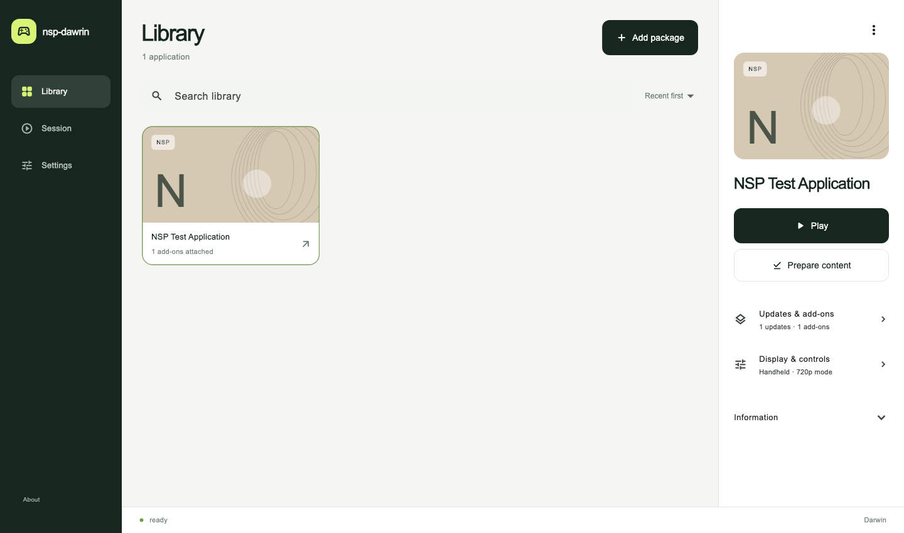
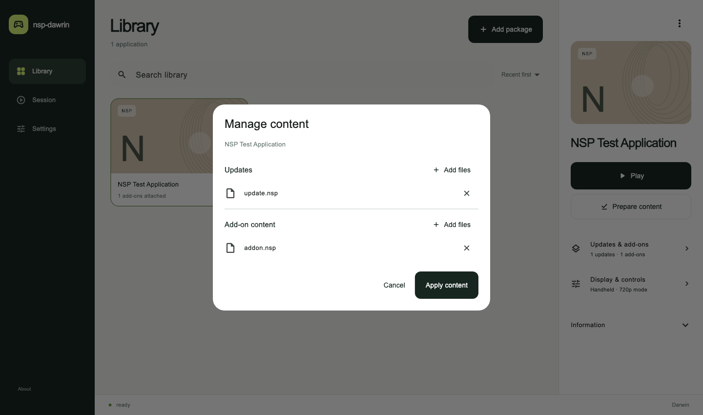
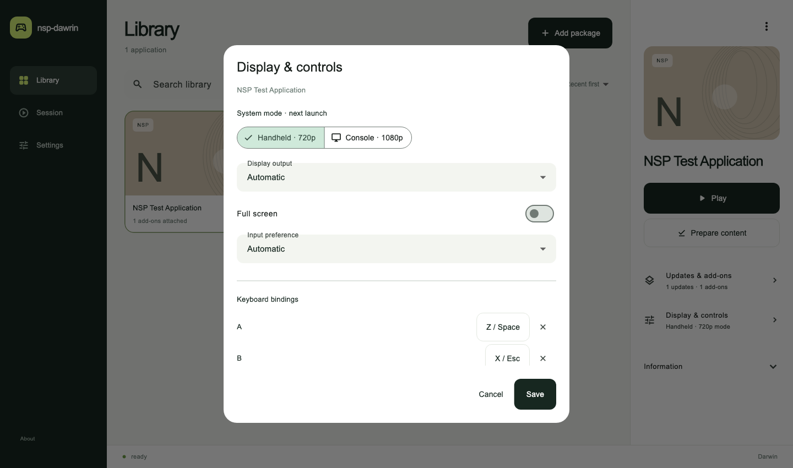

# nsp-dawrin

A cross-platform compatibility runtime and Flutter desktop launcher for NSP/XCI. Modular host backends and package tooling support macOS, Windows and Linux, with native ARM64 execution and Metal graphics on macOS.

- Manage a desktop library with a Flutter GUI: import packages, select updates/DLC, play and configure controls.
- Launch NSP/XCI content with resources read directly from the package.
- Prepare shaders through a modular Maxwell → SPIR-V → MSL pipeline.
- Use mouse touch, keyboard, and system-supported game controllers.
- Build portable service backends for macOS, Windows and Linux; see [backend architecture](docs/backend-architecture.md).
- Add engine adapters through [documented extension interfaces](docs/interfaces.md).

## Launch

Download the app for your platform from [Desktop GUI builds](https://github.com/hitsmaxft/nsp-dawrin/actions/workflows/desktop-gui.yml).
The current GUI connects to a built runtime checkout; follow the
[runtime setup](docs/development.md#native-runtime-build-macos) once before use.

1. Open the app and select the runtime folder and local key file in **Settings**.
2. Use **Add package** to add an NSP/XCI file to the library.
3. Select **Updates & add-ons** to associate updates and DLC, then **Play**.

Use **Display & controls** for fullscreen, display mode and keyboard bindings.
Choose a connected controller from the session controls.

| Capability | macOS | Windows | Linux |
| --- | --- | --- | --- |
| Desktop GUI, library and package/update/DLC preparation | Yes | Yes | Yes |
| Portable runtime services | Yes | Yes | Yes |
| Native guest execution and graphics | ARM64 / Metal | Planned | Planned |

See [desktop setup](docs/desktop-launcher.md) and [backend architecture](docs/backend-architecture.md).

Updates, DLC and controls

Application-only captures use the [original NSP fixture](docs/ci-fixture.md).

## Automated checks

CI generates an [original NSP test application](docs/ci-fixture.md) to verify
package/update/DLC loading and rewriting on all three platforms, plus guest
execution and failure detection on macOS ARM64.

## Validated games

Validation snapshot through `33ce145`: each game passed startup, rendered gameplay,
in-game menu interaction, and progress save/reload in a fresh process. These runs
reported zero shader loading failures.

| Game | Verified progress | Save scope |
| --- | --- | --- |
| Phoenix Wright: Ace Attorney Trilogy | Episode 1 opening dialogue; Options and Save/Load menus | Manual dialogue progress |
| Two Point Hospital | First hospital; camera tutorial completed, reception construction task reached | Hospital progress via Quick Save |
| Overcooked! 2 | Tutorial kitchen; movement, lettuce pickup and pause menu | Automatic tutorial checkpoint |

## Controls

Mouse press, drag, and release provide touch input. Coordinates follow window resizing. Choose Automatic, Keyboard only, or a connected controller in Settings. The selected extended-profile controller maps to player one, including sticks, face buttons, direction pad, shoulders, triggers, and menu buttons. Default positional mapping supports system-recognized Xbox and Pro controllers.

| Keyboard | Input |
| --- | --- |
| Z / Space | A |
| X / Escape | B |
| A | X |
| S | Y |
| Return | Primary menu |
| Arrow keys | Direction pad |

## Native game window settings

The macOS game window also provides native menus. Open **nsp-dawrin → Settings…** with **⌘,**. Use **View → Enter Full Screen** or **⌃⌘F** to toggle full screen.

- **System mode:** handheld (720p) or console (1080p), applied on the next game launch.
- **Display output:** automatic window/display sizing, 1280 × 720, or 1920 × 1080. Changes apply immediately to the presented image; the game chooses its internal render resolution. Full-screen output keeps a 16:9 aspect ratio.
- **Keyboard:** click one of the 24 binding buttons, then press a key. Bindings cover buttons, direction pad, and both sticks. Assigning an occupied key moves it to the selected action. Shift, Control, and Option keys are supported; Command shortcuts remain available for menus. Clear an individual binding or restore the defaults with Reset Keyboard.
- **Controller:** switch the active device immediately, use automatic selection, or disable controller input with Keyboard only. The preferred model is remembered; with multiple identical devices, select the desired device again after restarting.

Settings default to **This game** when an application is loaded. Each game keeps
its own display, keyboard and controller overrides and inherits unchanged
options from **Global defaults**. Select the scope at the top of Settings;
**Reset Game Settings** restores inheritance for that game. System mode applies
on the next launch; other settings apply immediately.

Global settings are saved to `~/Library/Application Support/nsp-dawrin/settings.json`,
with game profiles in the adjacent `profiles/` directory. Keyboard and controller
input are released when the game loses focus. See [feature design](docs/feature-design.md)
for the multi-game workflow and planned additions.

## Crash reports

After an unexpected runtime exit, open **Repair prompt** in the launcher's
session view and use **Copy prompt** to hand the diagnostics to a coding agent.
The native macOS report window also supports **Open GitHub Draft** and
**Copy Agent Prompt**. See [crash reporting](docs/crash-reporting.md).

## Development

See the [developer guide](docs/development.md) for source builds, script launch,
startup checks, shader diagnostics, and CLI/OCR automation.

## Acknowledgments

Thanks to [jhaizhou-ops/d2r-mobile](https://github.com/jhaizhou-ops/d2r-mobile) for publishing the implementation that forms the foundation of this project: ARM64 rewriting, host services, NVN command recording and Metal replay, and offline shader translation. Its explicit resource reflection and versioned caches also inform this macOS implementation.

Thanks also to [Peiikai / LASRecomp](https://github.com/peiikai/LASRecomp) for its launcher/settings ideas and atomic build-publication design reference.

This project builds on the work of many authors and maintainers. In particular, thank you to:

- **Ryujinx / Ryubing contributors** for the MIT-licensed `Ryujinx.Graphics.Shader`, `Spv.Generator`, and `Ryujinx.Common` libraries used for Maxwell-to-SPIR-V translation.
- **fincs and devkitPro** for [deko3d](https://github.com/devkitPro/deko3d), whose zlib-licensed texture layout algorithm is adapted in `nvn_tex.c`.
- **h1k421** for the MIT-licensed `nvn.h` graphics interface declarations.
- **Sergii Kudlai (iOrange)** for [bcdec](https://github.com/iOrange/bcdec), used for BC texture decoding under its MIT license option.
- **SciresM** for [hactool](https://github.com/SciresM/hactool), used as a reference for content container and patch-storage layouts.
- **libnx authors and contributors** for [libnx](https://github.com/switchbrew/libnx), used as a reference for content metadata and host service protocols.
- **Android Open Source Project contributors** for the public media codec interfaces used by the host's software codec selection policy.
- **Khronos Group and SPIRV-Cross contributors** for the SPIR-V definitions and [SPIRV-Cross](https://github.com/KhronosGroup/SPIRV-Cross) translation to Metal Shading Language.
- **Flutter and Dart authors**, and the maintainers of **file_selector** and **path**, for the desktop UI, native file dialogs and portable tooling.
- **UnityPy, cryptography, python-lz4, Capstone, Unicorn, Tesseract, Python, .NET, and LLVM contributors**, and the maintainers of their dependencies, for asset inspection, package reading, instruction verification, OCR, and the build tools.

See [Dependencies](docs/DEPENDENCIES.md) for component versions, authors, uses, and licenses, and [UPSTREAM.md](UPSTREAM.md) for source provenance.

## License

[GPL-3.0-or-later](LICENSE); see [COPYING](COPYING).
