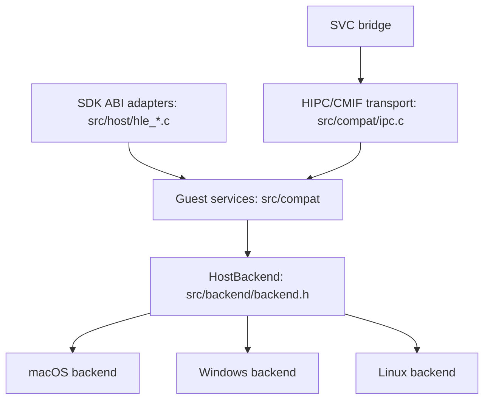

# Host backend boundaries

The portable service library builds on macOS, Windows and Linux. The full
native ARM64 launcher and Metal renderer currently build on macOS.



`HostBackend` is a versioned, immutable operation table selected at build time.
It has separate clock, entropy, memory-copy and synchronization modules. Public
contracts contain C types only. Backends never include guest structures, symbols,
service command IDs or engine adapters. The compatibility layer owns those
representations, result codes, capacity checks and service-object lifetimes.

| Module | macOS | Windows | Linux |
| --- | --- | --- | --- |
| Clock/calendar | POSIX clocks and local calendar | FILETIME, QPC and CRT calendar | POSIX clocks and local calendar |
| Entropy | getentropy | BCryptGenRandom | getentropy |
| Safe same-process copy | Mach VM | Read/WriteProcessMemory | process_vm_readv/writev |
| Synchronization | pthread mutexes | SRW locks | pthread mutexes |
| IPC/settings/time | Shared compatibility implementation | Shared compatibility implementation | Shared compatibility implementation |
| Guest execution | Existing native ARM64 rewriter/loader | Not implemented | Not implemented |
| Window/input/audio | Existing AppKit/GameController/AudioToolbox modules | Not implemented | Not implemented |
| Graphics replay | Existing Metal module | Not implemented | Not implemented |

A memory copy may fail after copying a prefix; callers must not assume rollback.
The IPC transport snapshots bounded requests before parsing them. Transport and
clock locks are non-recursive, with IPC before clock as the only nested order.
Handlers must not call transport APIs recursively.

## Extending another module

Keep guest adapters, reusable behavior and platform operations in separate files.
Add a module-specific contract when there is a real caller and implementation;
do not register a success-returning placeholder for an unavailable capability.
New backend tables must use explicit ownership and error results, with a native
contract test that runs without a game or window.

Window lifecycle and fullscreen belong to a presentation module; normalized input
snapshots and controller discovery belong to input; PCM devices belong to audio.
GPU replay remains separate from both presentation and shader translation.
Package/update/DLC resolution and engine-specific asset decoding stay outside all
of those platform modules. Existing macOS modules have not all moved behind new
tables yet: introducing a table is not evidence that a renderer or executor has
been ported.

LASRecomp recompiles guest code to host C. Our executor runs rewritten ARM64
instructions directly. An x86-64 Windows/Linux host therefore also needs a CPU
execution backend; adding Win32/POSIX system calls alone cannot run guest code.

## Build and test

```sh
cmake -S . -B build/services -DBUILD_TESTING=ON
cmake --build build/services --config Debug --parallel 2
ctest --test-dir build/services -C Debug --output-on-failure
```

This target compiles only portable services and synthetic tests. It does not need
packages, firmware, a graphics device, .NET or platform-vendor keys. The existing
`make -j4` target builds the complete macOS runner with the same service modules.
The `Host services` CI workflow runs the portable contracts on all three OSes.
